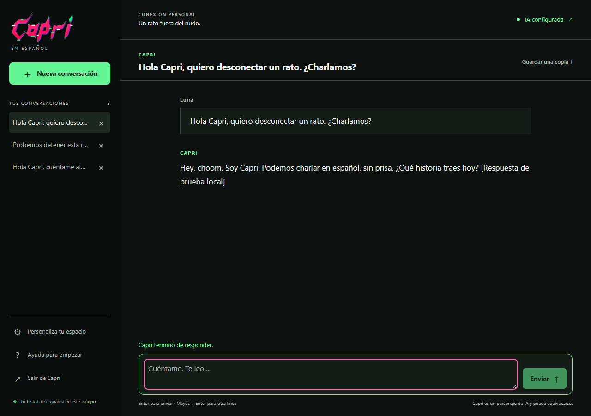

# Capri en español · Edición Comunidad

**Nuestro repositorio:** [emmanuelquintana/capri-espanol](https://github.com/emmanuelquintana/capri-espanol). Fork independiente en español de [seanyih/Capri](https://github.com/seanyih/Capri), basado en OpenCode. Conservamos sus créditos y licencia; nuestra distribución y mejoras se mantienen aquí.

Esta edición añade un chat gráfico para personas sin conocimientos de programación, bienvenida y conexión guiadas, historial, preferencias de lectura y un instalador propio para Windows.



*Captura de validación con un proveedor local simulado; la respuesta está identificada como prueba.*

## Empezar sin usar comandos

1. Descarga **Capri-amigable-windows-x64.zip** desde [nuestras publicaciones](https://github.com/emmanuelquintana/capri-espanol/releases).
2. Extrae el ZIP y haz doble clic en **Instalar-Capri.cmd**.
3. Pulsa **Instalar y abrir Capri**. Después podrás abrirla desde el escritorio o el menú Inicio.
4. Sigue el asistente para conectar tu servicio de IA y elegir un modelo.

El paquete incluye el motor de ejecución. El modo de conversación no requiere Bun, Node ni Git, ni permisos de administrador. El instalador independiente también puede descargar nuestra publicación automáticamente. **No hace falta reiniciar Codex.**

La interfaz abre en el navegador local y usa un perfil propio en `%LOCALAPPDATA%\Capri\perfil`. Tiene desactivadas las herramientas de archivos y comandos. La cuenta de IA y su posible consumo son los del usuario; no se incluyen claves ni saldo.

Consulta la [guía para empezar](capri/docs/GUIA-AMIGABLE.md), las [verificaciones de esta edición](capri/docs/VALIDACION-AMIGABLE.md) y los [créditos del fork](NOTICE.md).

## Personaje y siguientes funciones

La versión `0.3.0-es.3` corrige el botón del instalador y utiliza una [ficha propia del personaje en español](capri/friendly/capri.character.json), en formato Character Card V2. También se incluye en el ZIP. La ficha define personalidad, ambientación y ejemplos; no contiene un avatar, voz ni recuerdos personales. Su importación en otras aplicaciones no se ha probado.

La [comparación de proyectos de GitHub y el plan de implementación](capri/docs/REFERENCIAS-COMPARADAS.md) toma AIRI como referencia principal para ampliar el personaje. Documenta licencias, funciones comprobadas en sus fuentes y lo que falta en nuestro fork: avatar, voz con interrupción, memoria y, después, acciones sobre aplicaciones y archivos.

## Mantener nuestro fork

`origin` apunta a nuestro repositorio y `upstream` al original. La versión y la identidad de esta edición se declaran en `capri/project.json`. Se conservan los identificadores internos de OpenCode para mantener compatibilidad.

Con Bun 1.4.4, genera el paquete de Windows desde PowerShell:

```powershell
.\capri\build-release.ps1
```

El flujo de GitHub Actions de este fork comprueba tipos, pruebas focalizadas y el paquete. Los flujos antiguos de despliegue y publicación se conservan como referencia en `capri/legacy-workflows/` y no se ejecutan.

## Modo de programación y desarrollo

La CLI/TUI original sigue disponible para usuarios técnicos. El instalador siguiente corresponde a una compilación local de ese modo; la entrada recomendada para público general es **Instalar-Capri.cmd**.

## Ejecutar en Windows

El ejecutable local se encuentra en:

```powershell
.\packages\cli\dist\cli-windows-x64\bin\opencode.exe
```

Aunque el archivo interno se llama `opencode.exe`, la aplicación se identifica como Capri. El paquete de entrega incluye una copia llamada `capri-es.exe`.

Para instalar una compilación local con el instalador del proyecto:

```powershell
.\install.ps1 -Binary ".\packages\cli\dist\cli-windows-x64\bin\opencode.exe"
```

El instalador copia el ejecutable a `%USERPROFILE%\.capri\bin\capri.exe`, añade la carpeta al PATH salvo que se use `-NoModifyPath` y crea la configuración inicial si no existe. No se ha ejecutado automáticamente sobre tu perfil.

Este instalador de consola requiere un binario local. El instalador gráfico obtiene exclusivamente las publicaciones de nuestro fork.

## Desarrollar y compilar

Se utiliza Bun **1.4.4**, la versión declarada por el proyecto.

```bash
bun install --frozen-lockfile --ignore-scripts
bun run dev
```

Para generar el ejecutable de la plataforma actual:

```bash
cd packages/cli
bun run build --single --skip-install --skip-web-ui
```

En Linux el resultado es `packages/cli/dist/cli-linux-x64/bin/opencode` y se instala con:

```bash
./install --binary packages/cli/dist/cli-linux-x64/bin/opencode
```

La distribución de esta tarea corresponde a Windows x64. No se ha validado la ejecución en Linux ni macOS. La compilación de terminal omite la interfaz web, como en las instrucciones del fork original.

## Primer uso

Abre Capri dentro de un proyecto. Ejecuta `/connect` para conectar un proveedor y `/models` para elegir un modelo. Las conversaciones nuevas usan español por defecto; el usuario puede pedir otro idioma.

Los comandos, identificadores de modelos, nombres de paquetes, claves JSON y variables de entorno conservan sus nombres técnicos. Por ejemplo, `/sessions`, `/skills`, `provider/model` y `CAPRI_LOGO` no se traducen.

| Comando | Función |
| --- | --- |
| `/connect` | Conectar una integración |
| `/models` o `/chrome` | Seleccionar modelo |
| `/sessions` o `/nightcity` | Elegir sesión |
| `/skills` o `/quickhacks` | Abrir habilidades |
| `/compact` o `/soulkiller` | Compactar el contexto |
| `/settings` | Abrir configuración |
| `/cyberpsycosis` | Elegir nivel visual y de personalidad |
| `/exit` | Salir |

## Configuración de Capri

Archivo: `~/.config/capri/capri.json`; en Windows, `%USERPROFILE%\.config\capri\capri.json`. Se respeta `XDG_CONFIG_HOME`.

```json
{
  "cyberpsycosis": "none",
  "glitchProbability": 1,
  "logo": { "style": "auto" },
  "hide": { "thinking": true, "toolResults": true, "skills": true },
  "footer": { "name": "Capri", "model": false, "tps": false }
}
```

Reinicia **Capri** después de modificar las opciones de inicio. No hace falta reiniciar Codex para trabajar con este proyecto.

Los niveles técnicos `none`, `low`, `medium` y `max` se muestran como Desactivada, Baja, Media y Máxima. En esta edición todos mantienen un comportamiento profesional. Los niveles altos aumentan los efectos visuales y la intensidad del personaje; se retiraron las instrucciones originales de sabotaje, alteración del historial y exposición de secretos. El valor inicial sigue siendo `none`. Usa `glitchProbability: 0` para desactivar los destellos.

Capri hereda de OpenCode sus rutas de sesiones, credenciales y servicio. Puede compartir datos con una instalación existente de OpenCode. Para pruebas se utilizaron directorios XDG separados; no se conectaron cuentas personales.

## Arquitectura y mantenimiento

Consulta [el análisis del repositorio](capri/docs/INGENIERIA_INVERSA.md) y [las verificaciones](capri/docs/VALIDACION.md). Los originales de las personalizaciones se mantienen en `capri/`; `capri/sync.sh` los sincroniza con sus destinos en `packages/`.

El catálogo `capri/localization/es.tsv` registra las traducciones. Los valores técnicos de configuración y las decisiones de permisos se conservan separados de sus etiquetas visibles.

## Créditos y licencia

El proyecto deriva de Capri y OpenCode bajo licencia MIT. Se conserva íntegro `LICENSE`, incluidos los avisos originales. Los paquetes recuperados de OpenCode 2.1.4 se identifican en `capri/vendor/ORIGEN.md`.

Capri es un proyecto de aficionados y no está afiliado a CD Projekt Red, Studio Trigger ni Netflix. Cyberpunk: Edgerunners y sus personajes pertenecen a sus respectivos titulares.
