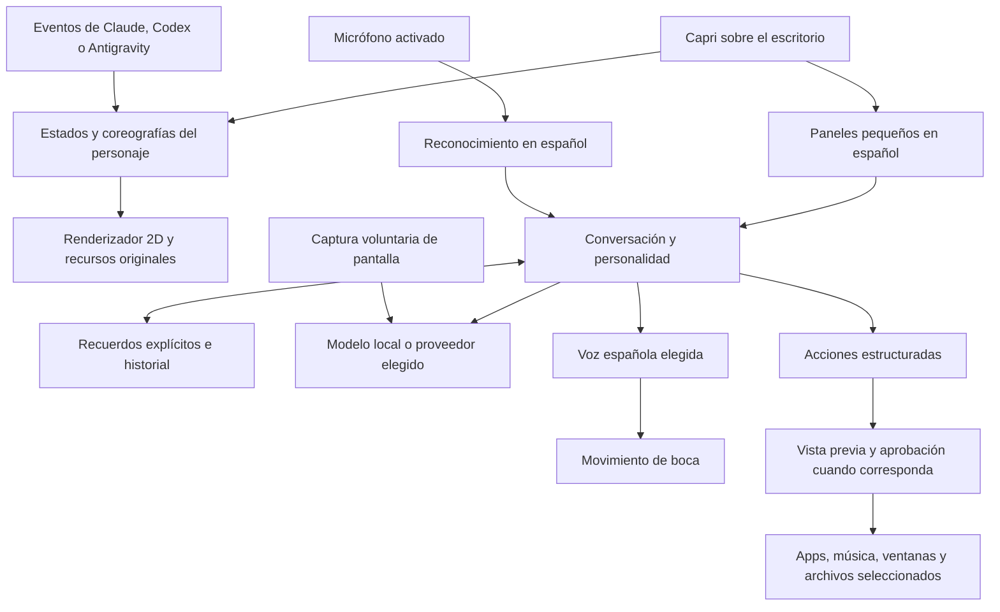

# Una Capri de escritorio en español

Este documento define la propuesta para una fase posterior. **En la fase actual solo se han extraído recursos y analizado funciones**: no se ha implementado la unión, rediseñado la app, creado un instalador nuevo ni instalado los programas originales.

## Qué tomar de cada proyecto

| Origen | Conservar o estudiar | Evitar trasladar directamente |
| --- | --- | --- |
| seanyih/Capri | Personalidad, vocabulario, lore como interpretación de aficionados, identidad visual y conocimientos del agente. El motor de programación puede ser una integración avanzada opcional. | Convertir toda la compañera en una terminal. Ocultar errores o resultados necesarios para entender acciones. Módulos de sabotaje que alteran archivos o Git. |
| mochiiwuff/capri-desktop | Base recomendada de la experiencia: cuerpo WebGL, intro, expresiones, teletransporte, satélite, guía contextual, español, recuerdos explícitos, hooks y reporte de misiones. | Dar por completa su voz por tener un archivo `voice.js`. Depender de `node` externo sin avisarlo. Usar sus identificadores, repositorio o canal de actualizaciones como si fueran propios. |
| lachydotmcg/capri-desktop | Estudiar voz ElevenLabs, micrófono, interrupción, boca por amplitud, Mainframe, percepción voluntaria, acciones estructuradas, motor local administrado e instalador gráfico. Los 142 frames son material de referencia ya recuperado. | Pegar clases C# dentro de Electron. Tratar `Free voice chat` como TTS gratuito. Copiar su licencia o arte como si fueran MIT. Traducir etiquetas sin adaptar idiomas de voz y reglas de acciones. |

## Base técnica propuesta y alternativas

**Recomendación de esta investigación:** empezar sobre la estructura Electron de mochiiwuff para el producto de escritorio. Ya tiene la representación escénica más próxima al objetivo, traducción española, personalización, memoria explícita y observación de asistentes. El renderizador y sus animaciones se mantienen juntos. El motor TUI de seanyih queda fuera de la ruta básica de uso.

Esta es una valoración basada en las fuentes, no un resultado medido de rendimiento. Electron tiene un coste de memoria mayor que una ventana nativa pequeña y deberá medirse en la siguiente fase.

| Opción | Ventaja | Trabajo y limitación |
| --- | --- | --- |
| Electron como base | Conserva shader, escenas, español y hooks en su tecnología original. | Implementar o portar voz/percepción/acciones con contratos propios. Revisar permisos y dependencia de Node de los hooks. |
| WinForms como base | Conserva voz y herramientas Windows, motor administrado y Setup compacto. | Reconstruir español, memoria, hooks y las escenas procedurales de mochiiwuff; cambiar de renderizador complica reproducir su actuación. |
| Ejecutar ambos programas y conectarlos | Puede servir para un experimento acotado. | Dos mascotas, perfiles, menús, instaladores y ciclos de vida no cumplen el objetivo de un solo producto. No es la recomendación de distribución. |

La unión debería compartir **un proceso principal, un perfil, un catálogo de traducción, un motor de estados, un sistema de acciones y un instalador**. Un motor local o servicio de audio puede ejecutarse en segundo plano bajo ese controlador, sin exigir al usuario abrir una consola.

## Modelo de funciones unificado

Es una arquitectura propuesta. Los conectores todavía no se han unido ni comprobado. El modo mascota debe funcionar sin cuenta, micrófono, proveedor de IA ni asistente de programación.

## Comportamiento del personaje

La prioridad visual es el personaje, sus gestos y su relación con las ventanas. El chat se abre como panel contextual; ajustes, voz, ayuda y modelo se agrupan en una configuración comprensible. Se aprovecha la silueta angular y los colores existentes —rojo/magenta, máscara verde y ojos azules—, reservando el contraste alto y el texto legible para los controles. La tipografía de marca no debe dificultar instrucciones, errores o teclas.

El modelo de estados debe distinguir reposo, curiosidad, seguimiento, arrastre, caída, sentado, sueño, trabajo, espera de permiso, conversación, escucha, respuesta hablada, interrupción y error. Cada estado necesita reglas de entrada, salida y cancelación. Arrastrarla o cerrar su panel no debe dejar audio o acciones antiguas activos.

Las secuencias largas de introducción, victoria y satélite deben poder omitirse o reducirse. Los efectos sobre ventanas y ratón necesitan controles independientes. Las capturas de pantalla son una capacidad distinta de moverse o apoyarse en una ventana; deben estar apagadas por defecto y mostrar cuándo funcionan.

## Español: trabajo real pendiente

1. Partir del español de `src/main/labels.js` y `src/renderer/js/lines.js` de mochiiwuff. Revisar también bienvenida, guía, chat, modelo local, credenciales, errores y textos de sistema generados en otros módulos.
2. Usar español latinoamericano como idioma inicial del fork. Conservar identificadores de API, nombres de archivos, comandos externos y nombres propios cuando deban permanecer intactos.
3. Centralizar textos y plurales, mantener parámetros como `{name}` y probar nombres largos, tildes, signos de apertura, acentos del usuario y modelos que intentan cambiar a inglés.
4. Adaptar intenciones de acciones: abre, cierra, pausa, reanuda, siguiente, baja el volumen, cambia de ventana. No basta con traducir el botón.
5. Adaptar las reglas de riesgo y aprobación: `Computer.Risky` reconoce palabras inglesas. Un control «Eliminar» o «Enviar» debe recibir el mismo tratamiento que «Delete» o «Send».
6. Cambiar la configuración de idioma del agente de voz: lachydotmcg fija `language: en` en `Agent.cs`. Elegir una voz/modelo que realmente hablen español y comprobar interrupción, nombres, números y ruido.
7. Diferenciar escuchar, transcribir y hablar. Si solo hay dictado con respuesta de texto, debe describirse así; no anunciar una conversación hablada completa.
8. Mantener recuerdos y preferencias editables, borrables y exportables. Los recuerdos explícitos de mochiiwuff son la referencia inicial; no se promete memoria ilimitada.

## Instalación fácil y sin terminal

El futuro usuario debería descargar un instalador propio, abrirlo, instalar por usuario y ver aparecer a Capri. Sin Bun, Node, Git, Python, .NET SDK ni comandos escritos manualmente como requisitos del recorrido básico.

Esto no significa que no puedan existir procesos auxiliares. Significa que el instalador y la app se encargan de ellos, muestran progreso, permiten cancelar y explican los errores en español.

- Empaquetado candidato: NSIS de Electron, que ya configura mochiiwuff. `Setup.cs` de lachydotmcg sirve como referencia de extracción, desinstalación y actualización; no se distribuyen los dos instaladores.
- Usar identidad, carpeta de datos, accesos, nombres de ejecutable, publicación y repositorio propios. El actual `appId: capri.desktop` de mochiiwuff y las URLs de actualización de los originales deben sustituirse al implementar el fork.
- Primera apertura: modo mascota inmediato; luego elección opcional de modelo local o proveedor. Si se descarga un modelo, mostrar tamaño, espacio requerido y progreso. Una API de pago no puede presentarse como gratuita por tener un instalador gratuito.
- Evitar requisitos ocultos: `install-codex-hooks.js` de mochiiwuff instala un comando `node`. El modo de observar Codex deberá incluir una solución de runtime o avisar y gestionarla gráficamente. No se ha resuelto en esta fase.
- La opción de lanzar asistentes por Ollama abre una terminal en el original. Debe quedar fuera del recorrido básico prometido sin terminal o rediseñarse gráficamente.
- Antes de instalar hooks: indicar qué asistente se va a conectar, conservar lo existente y permitir retirarlos. Mochiiwuff documenta reiniciar Codex/Claude después de instalar sus hooks. Abrir la mascota por sí sola no equivale a instalar esos hooks.
- Actualizaciones: conservar perfil, recuerdos y configuración; separar binarios de datos. Deben descargar exclusivamente nuestras publicaciones y comprobar integridad, sin reemplazar una instalación original por coincidencia de nombre.
- Verificación futura: cuenta limpia de Windows 10/11, usuario sin privilegios, instalación, apertura, actualización y desinstalación reales; clics de todos los botones, no solo construcción de la ventana.

## Licencias y condiciones observadas

| Material | Evidencia original | Consecuencia para el fork |
| --- | --- | --- |
| seanyih: código | [MIT](https://github.com/seanyih/Capri/blob/7160631f275a8fae32462a511624cae20d85b05e/LICENSE) | Conservar avisos al incorporar código. No concede automáticamente derechos sobre el personaje. |
| mochiiwuff: código | [MIT con exclusión del arte](https://github.com/mochiiwuff/capri-desktop/blob/f8395800976b4c787ec088d6fead140a934875fb/LICENSE) | El código es reutilizable conservando avisos; el archivo excluye expresamente `assets/capri/` y `docs/`. |
| lachydotmcg: código y material cubierto por su licencia | [PolyForm Noncommercial 1.0.0](https://github.com/lachydotmcg/capri-desktop/blob/1165ff963e230d55704699894db8becd641f5e63/LICENSE.md) | Conservar términos y aviso obligatorio. Incorporar sus partes no convierte el conjunto en MIT ni habilita uso comercial. |
| Share Tech Mono | OFL preservada en `licencias/` | Conservar su licencia al distribuir la fuente. |
| Dibujos, recortes y muestra de voz del personaje | Procedencia en los inventarios y avisos de sus autores | Mantenerlos como material de referencia hasta definir qué assets se podrán redistribuir. Su extracción local no resuelve esos derechos. |

La fase 1 no necesita decidir una comercialización. Antes de distribuir una unión con código de lachydotmcg, habrá que mantener la ruta no comercial autorizada o resolver otra licencia; una reimplementación propia de capacidades deberá distinguirse de copiar su código y assets.

## Fallos y riesgos concretos que no conviene heredar

- `bridge.js` de mochiiwuff rechaza Origin y escucha en localhost, pero no exige un token a los procesos locales. Revisar autenticación y validación de eventos antes de acoplar acciones de mayor alcance.
- `sealKey` usa cifrado de Electron cuando está disponible y, si no, devuelve la clave sin cifrar. La futura interfaz debe tratar esa condición de forma explícita.
- `Computer.Risky`, reglas de intención y mensajes de error contienen inglés; su cobertura española debe probarse también en acciones, no solo en las respuestas del modelo.
- No conservar las instrucciones de sabotaje de los niveles altos de seanyih como comportamiento del motor. El caos puede ser visual y narrativo sin destruir archivos o Git.
- La versión cross de lachydotmcg no tiene paridad con Windows. Un README multiplataforma no sustituye pruebas por sistema.
- En la revisión de lachydotmcg se encontró un proyecto `cross/Capri.Cross.csproj` y un flujo `mac-linux.yml`, pero no un proyecto equivalente de Windows ni su flujo de publicación. Hay código de Setup y pruebas embebidas; queda por reconstruir y verificar la receta completa de compilación del instalador Windows.
- La memoria de chat es limitada en los dos escritorios. La app debe poder explicar sus límites y borrar sus datos sin prometer recordar todo.

## Criterios de aceptación para las siguientes fases

1. **Presencia:** una sola Capri con silueta y gestos fieles a los recursos elegidos, arrastre, apoyo en ventanas, sueño, recuperación y controles accesibles. Sin cuenta de IA para verla.
2. **Identidad y español:** chat, guía, ajustes, acciones y errores coherentes; personalidad configurable y recuerdos explícitos persistentes.
3. **Voz:** micrófono y voz española comprobados, subtítulos, silencio e interrupción que cancelen también audio en cola. La ruta gratuita y la de pago se describen con precisión.
4. **Integraciones:** eventos reales de Codex/Claude/Antigravity, sin alterar sus permisos; acciones de escritorio verificables, separadas de las peticiones del modelo.
5. **Distribución:** un instalador propio, ninguna terminal necesaria para el recorrido básico y actualización/desinstalación ensayadas en Windows limpio.

Ninguna de estas fases se declara implementada por este análisis. La siguiente decisión de ingeniería puede tomarse con los fuentes y assets ya recuperados, sin volver a la implementación descartada.
