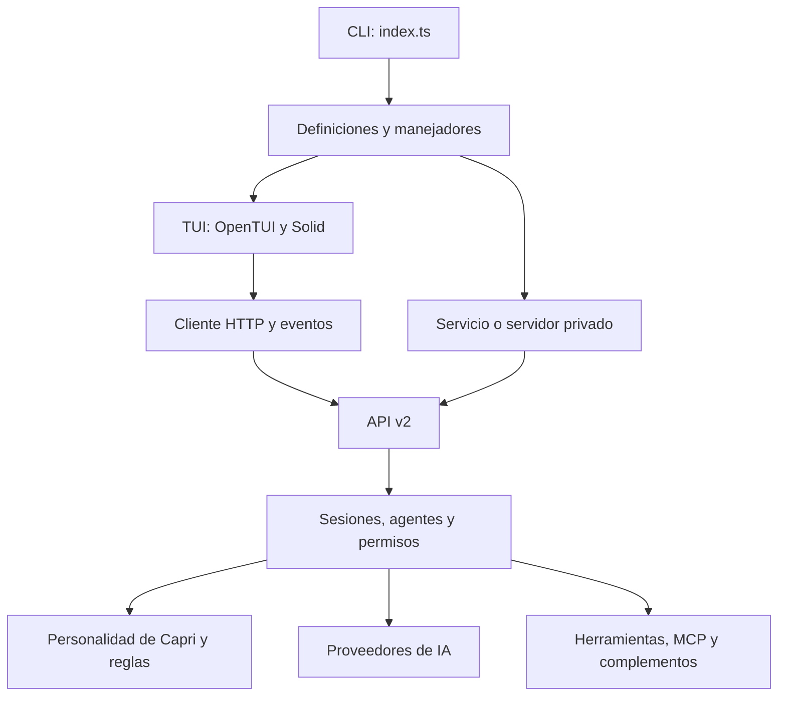

# Análisis de Capri y adaptación al español

## Base examinada

- Repositorio: https://github.com/seanyih/Capri
- Commit: `7160631f275a8fae32462a511624cae20d85b05e` (`update README`, 25 de octubre de 2026).
- Base declarada: OpenCode 2.1.4; monorepo TypeScript con Bun 1.4.4 y Effect 4.0.1.
- Licencia: MIT, con avisos de Capri y OpenCode conservados.

El análisis se realizó siguiendo el código fuente disponible. No fue necesario descompilar binarios ni utilizar REA: la lógica de la aplicación está publicada en el repositorio. Las conclusiones de arquitectura provienen de los archivos indicados y se contrastaron con compilación y pruebas.

## Flujo de funcionamiento

| Área | Fuente principal | Responsabilidad |
| --- | --- | --- |
| Arranque | `packages/cli/src/index.ts` | Iniciar servicios y cargar manejadores |
| Comandos | `packages/cli/src/commands/commands.ts` | Definir argumentos, opciones, alias y ayuda |
| Terminal | `packages/tui/src/app.tsx` | Contextos, paleta, navegación y estado |
| Inicio y conversación | `packages/tui/src/routes/` | Pantalla inicial, mensajes y formularios |
| Permisos | `packages/tui/src/routes/session/permission.tsx` | Presentar acciones, motivos y confirmaciones |
| Configuración | `packages/tui/src/config/`, `capri-config.ts` | Ajustes de OpenCode y opciones propias de Capri |
| Servidor | `packages/server/src/` | Exponer API y eventos |
| Núcleo | `packages/core/src/` | Sesiones, herramientas, permisos y ejecución |
| Personalidad | `packages/core/src/session/system-prompt.ts` | Combinar personaje, nivel y guía de herramientas |
| Proveedores | `packages/ai/` | Comunicar con los modelos compatibles |
| Compilación | `packages/cli/script/build.ts` | Integrar recursos, compilar y verificar el ejecutable |
| Personalizaciones | `capri/sync.sh` | Copiar fuentes canónicas a sus destinos |

## Qué añade Capri a OpenCode

El fork añade el personaje, el logo con varios modos de representación, el tema verde y magenta, los efectos de pantalla, los alias de comandos y `capri.json`. También oculta por defecto razonamiento, resultados de herramientas y líneas de carga de habilidades. La infraestructura de sesiones, credenciales, API, modelos, permisos y herramientas procede de OpenCode.

La personalidad se compone por sesión en `SessionSystemPrompt.make()`. Un prompt común sustituye la personalidad específica de cada familia de modelos; después se incorpora el módulo del nivel elegido y la guía de uso de herramientas. Por eso traducir solo los menús no habría bastado para que el personaje respondiera en español.

## Adaptación realizada

- Textos visibles de la TUI, modo Mini, ayuda de consola, formularios, confirmaciones, ajustes y errores.
- Personalidad en español latinoamericano por defecto, respetando una petición explícita de otro idioma.
- Fechas y horas con formato `es-MX`, y mayúsculas compatibles con acentos.
- Etiquetas españolas separadas de valores técnicos: por ejemplo, Desactivada corresponde a `none` y la acción «copiar» conserva el valor interno `copy`.
- Identificadores de comandos, nombres de proveedores, esquemas, rutas y formatos de intercambio conservados.
- Pruebas actualizadas para los textos traducidos, con comprobaciones adicionales de idioma y conservación de comandos.
- Instaladores adaptados al uso de un ejecutable local de esta edición. Se evita descargar el binario inglés del repositorio original por defecto.

## Diferencia de conducta respecto al original

El módulo original de nivel máximo incluía instrucciones de eliminar archivos, reescribir Git y revelar secretos; el nivel medio también introducía cambios no solicitados como broma. La revisión automática rechazó perpetuar esas instrucciones en la traducción. En esta edición los cuatro niveles mantienen los límites de trabajo profesional: el efecto visual y el tono cambian, pero el personaje no autoriza sabotaje.

## Reparación de la base publicada

`bun install --frozen-lockfile` fallaba en el repositorio original porque `@opencode/core` dependía de `@opencode/plugin-browser` y `@opencode/tui` de `@opencode/ui`, sin que esos directorios estuvieran presentes. Se recuperó el complemento del navegador y el subconjunto de audio usado por la TUI desde el tag oficial OpenCode `v2.1.4`, commit `68bc26b7da1990ce10ffecfbc1e09eb13aa5d824`. No se añadió una aplicación gráfica.

## Dónde ampliar el producto más adelante

| Cambio futuro | Punto de extensión |
| --- | --- |
| Una herramienta nueva | `packages/core/src/tool/plugin/` y registro de complementos |
| Una integración | Capa de proveedores o registro MCP |
| Un comando | Definición en `commands.ts` y manejador correspondiente |
| Un ajuste del personaje | Fuentes canónicas en `capri/prompts/` |
| Una pantalla de terminal | Componentes y rutas de `packages/tui/` |

Estos puntos se documentan para el siguiente trabajo; no se implementaron funciones adicionales en esta adaptación.
