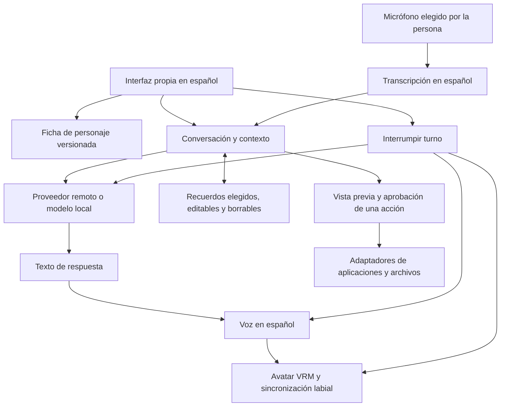

# De chat a compañera: referencias para Capri en español

Revisión documental: 26 de octubre de 2026, hora de México. Prioridad elegida: **personaje primero; después asistente de aplicaciones y archivos**. Esta comparación examina fuentes y documentación oficiales; no certifica el funcionamiento de los proyectos en este equipo. Las revisiones consultadas quedan en [referencias-revisiones.json](referencias-revisiones.json).

## Decisión

Usar **AIRI como referencia principal para voz, avatar y coordinación de estados**, Character Card V2 como formato portable para nuestra personalidad y Letta como referencia para una memoria que pueda inspeccionarse. Conservar nuestro repositorio, instalador e identidad. El motor heredado de OpenCode puede seguir sosteniendo el chat y, más adelante, herramientas autorizadas; por sí solo no resuelve una compañera animada.

Esto es una decisión de arquitectura del fork, no una integración ya realizada. Copiar aplicaciones enteras añadiría motores, configuraciones y ciclos de actualización incompatibles con la experiencia de un solo instalador. Primero conviene cerrar un recorrido completo: abrir → conversar en español → escuchar → interrumpir → volver a abrir y recuperar recuerdos elegidos.

## Proyectos comparados

| Proyecto y evidencia primaria | Qué aporta al objetivo | Estado y licencia observados | Uso propuesto |
| --- | --- | --- | --- |
| [AIRI](https://github.com/moeru-ai/airi#current-progress--roadmap) | Reconocimiento y síntesis de voz, renderizadores Live2D/VRM, animaciones; paquetes de audio y presentación separados. | Código raíz [MIT](https://github.com/moeru-ai/airi/blob/main/LICENSE). Su hoja de ruta todavía marca la memoria avanzada como pendiente. | Referencia principal del personaje. Estudiar `pipelines-audio`, `stage-ui-live2d` y `stage-ui-three`; revisar licencias de dependencias y assets antes de incorporar módulos. |
| [Open-LLM-VTuber](https://github.com/Open-LLM-VTuber/Open-LLM-VTuber#-features--highlights) | Conversación hablada, interrupción, expresiones y modo de mascota. | Backend [MIT con excepción de modelos Live2D](https://github.com/Open-LLM-VTuber/Open-LLM-VTuber/blob/main/LICENSE); el [frontend tiene licencia propia](https://github.com/Open-LLM-VTuber/Open-LLM-VTuber-Web/blob/main/LICENSE), con condiciones comerciales. El README indica que retiraron temporalmente la memoria a largo plazo. | Referencia del ciclo de audio y de interrupción. No asumir que todo el conjunto se puede redistribuir bajo MIT. |
| [SillyTavern](https://github.com/SillyTavern/SillyTavern) y [su documentación de personajes](https://docs.sillytavern.app/usage/core-concepts/characterdesign/) | Separación entre descripción, personalidad, escenario, saludos e historial; ecosistema de tarjetas de personaje. | Código [AGPL-3.0](https://github.com/SillyTavern/SillyTavern/blob/release/LICENSE). Un formato interoperable no exige copiar su implementación. | Inspiración de producto y uso de [Character Card V2](https://github.com/malfoyslastname/character-card-spec-v2). Nuestra ficha es redacción propia, sin código de SillyTavern. |
| [Letta Code](https://github.com/letta-ai/letta-code) | Identidad y memoria persistentes, bloques de contexto y herramientas para inspeccionarlos. | [Apache-2.0](https://github.com/letta-ai/letta-code/blob/main/LICENSE). El [repositorio Letta anterior](https://github.com/letta-ai/letta) remite ahora a `letta-code`; el servidor V1 queda en `archive`. | Referencia de memoria separada del historial. Evaluar API y almacenamiento antes de introducir otro servicio obligatorio. |
| [three-vrm](https://github.com/pixiv/three-vrm) | Carga y animación de modelos VRM mediante Three.js. | Motor [MIT](https://github.com/pixiv/three-vrm/blob/dev/LICENSE). Los modelos tienen sus propios permisos. | Primera ruta propuesta para un avatar importable; validar parpadeo, expresiones y movimiento de boca con un modelo autorizado. |
| [whisper.cpp](https://github.com/ggml-org/whisper.cpp) | Transcripción local y ejemplos de captura de audio; modelos multilingües. | Código [MIT](https://github.com/ggml-org/whisper.cpp/blob/master/LICENSE). Requiere descargar y probar el modelo adecuado. | Candidato para reconocimiento en español, con selección de micrófono y opción de texto si el equipo no sostiene la voz. |
| [Piper actual](https://github.com/OHF-Voice/piper1-gpl) | Síntesis local de voz. | Motor [GPL-3.0](https://github.com/OHF-Voice/piper1-gpl/blob/main/COPYING), no MIT. Cada voz tiene condiciones en su [MODEL_CARD](https://github.com/OHF-Voice/piper1-gpl/blob/main/docs/VOICES.md). | Candidato a evaluar; no se empaqueta en esta edición. Elegir una voz española con permisos verificados antes de distribuirla. |
| [Ollama](https://github.com/ollama/ollama) | Ejecución de modelos locales y API para conectarlos. | Aplicación [MIT](https://github.com/ollama/ollama/blob/main/LICENSE); las licencias y requisitos de cada modelo son independientes. | Ruta opcional para conversación local. No prometer ejecución offline en cualquier PC ni descargar modelos pesados sin una elección visible. |

Las licencias anteriores describen los archivos consultados, no todos los componentes transitivos. Esta entrega no incorpora código, voces ni avatares de esos proyectos.

## Qué existe hoy en nuestro fork

| Capacidad | Estado en 0.3.0-es.3 |
| --- | --- |
| Chat gráfico en español, conexión guiada, selección de modelo, historial, exportación y preferencias | Implementado; se conserva la validación con proveedor local simulado de la edición anterior. |
| Instalación Windows con un archivo y comprobación de integridad | Corregida la colisión de variables de PowerShell. Nueva prueba que pulsa el botón real y comprueba el archivo instalado. |
| Personalidad propia separada del motor | Nueva ficha `capri/friendly/capri.character.json`, usada por las instrucciones del agente del chat e incluida en el ZIP. |
| Saludos y ejemplos portables del personaje | Incluidos en la ficha V2. El chat utiliza descripción, personalidad, escenario, instrucciones y ejemplos; no aplica los saludos automáticamente. Importación externa no probada. |
| Avatar animado, sincronización labial y expresiones | Pendiente. El logotipo actual no es un avatar animado. |
| Entrada/salida de voz en español e interrupción | Pendiente. |
| Memoria personal entre conversaciones | Pendiente. El historial y las preferencias actuales no son memoria semántica. |
| Usar aplicaciones, pantalla y archivos desde el modo amigable | Pendiente. Las herramientas siguen denegadas en este modo. |

La historia de la ficha adapta la interpretación del repositorio de origen. No se presenta como canon oficial. Los derechos del personaje, un modelo visual y una voz no se obtienen por la licencia del código.

## Arquitectura propuesta

Las flechas de voz, avatar, memoria y acciones describen trabajo futuro. La ficha y el chat ya están conectados. Mantener la personalidad en datos permite cambiar de proveedor sin reescribir su identidad. La interrupción debe cancelar el turno completo, incluido el audio en cola, para impedir que se reproduzcan respuestas viejas después de una nueva pregunta.

## Orden de implementación y condiciones para darlo por terminado

1. **Identidad del personaje.** Ficha propia versionada y usada por el chat: entregada. Siguiente: probar continuidad del tono en conversaciones largas, enfado del usuario y cambio de idioma con un proveedor real. No basta con comprobar que existe un prompt.
2. **Cuerpo.** Integrar un renderizador VRM, importación local con errores comprensibles y un avatar cuyos permisos podamos documentar. Debe parpadear, reaccionar y recuperar su posición al volver a abrir. Si falla el modelo, el chat sigue disponible.
3. **Voz.** Una ruta de STT y una de TTS en español, prueba de micrófono y altavoces, subtítulos y botón de interrupción. Validar español mexicano, nombres propios, silencio, ruido, denegación de micrófono y desconexión. No usar una clonación de voz como requisito de instalación.
4. **Memoria.** Separar mensajes de recuerdos; guardar hechos con procedencia y decisión de la persona. Ofrecer ver, editar, borrar y desactivar. Validar recuperación al reiniciar, correcciones, contradicciones y que un recuerdo borrado deje de inyectarse al contexto.
5. **Asistente.** Añadir primero una acción real y acotada sobre archivos seleccionados por la persona. Mostrar qué va a ocurrir, pedir aprobación de la acción y registrar su resultado real. Una negativa debe mantener la conversación y cancelar la acción.
6. **Distribución para público general.** Incorporar al instalador únicamente los componentes elegidos, con descargas reanudables, diagnóstico en español y actualización que conserve el perfil. Verificar en una cuenta limpia de Windows sin Bun, Node ni Git, con modelos ausentes y red interrumpida.

Para denominarla «compañera completa» deben pasar conjuntamente las etapas 1 a 4 en el paquete distribuido. Para «asistente completo» también la etapa 5. La publicación actual corrige la instalación y prepara la identidad; no cumple todavía esas condiciones.

## Corrección del instalador de la captura

`Install-Capri([scriptblock]$Progress)` ocultaba dinámicamente el control WinForms `$progress`: PowerShell no distingue mayúsculas y minúsculas. El callback intentaba asignar `.Value` a un bloque de código. Se renombraron el callback a `$ReportProgress` y el control a `$progressBar`.

`capri/tests/installer-gui.test.ps1` abre el formulario fuera de pantalla, pulsa su botón real y verifica progreso al 100 %, instalación y SHA-256 en una carpeta temporal. La misma prueba falló antes del cambio con el error de la captura y pasó después. La prueba silenciosa anterior y la mera creación de la ventana no cubrían ese recorrido. Se añadió al flujo Windows de nuestro repositorio.

También pasó con el paquete compilado de `0.3.0-es.3`, comprobando la versión del ejecutable ya instalado sin abrir la aplicación ni crear accesos directos.
